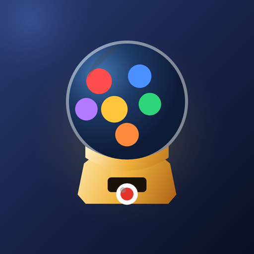
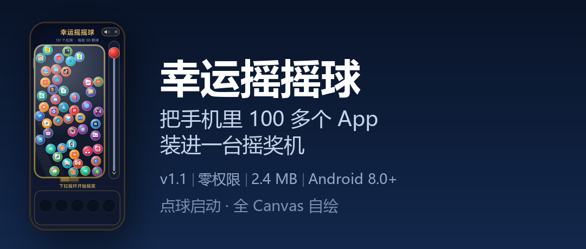
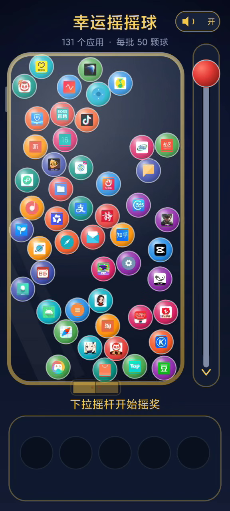
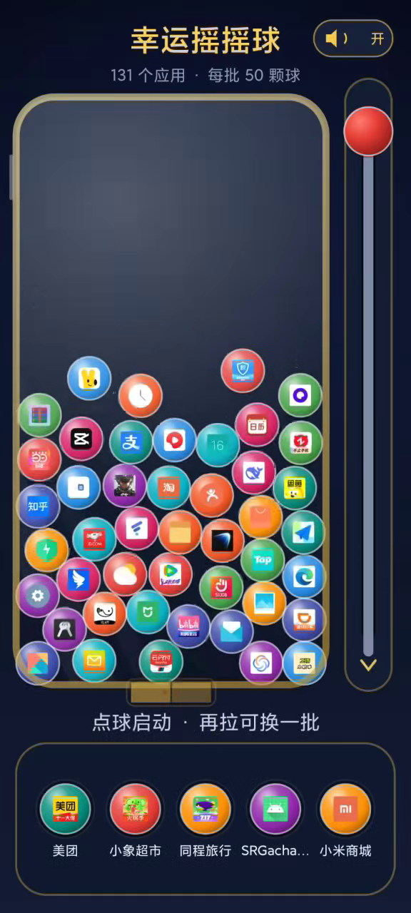

# 幸运摇摇球（Lucky Shake Ball）

把手机里的应用全部装进一台摇奖机：拉动摇杆，彩球在玻璃舱里翻滚，停下来从出奖口掉出 5 颗球，点球就能启动对应的 App。

一个安卓小工具，装上去你会发现——**每天打开哪个应用这件事，本来就不需要认真选择。**

- 版本：v1.1（versionCode 2）
- 包名：`com.workbuddy.lottery`
- 支持：Android 8.0+（minSdk 26 / targetSdk 34）
- 安装包 2.4 MB，**零权限**（无 INTERNET、无 QUERY_ALL_PACKAGES）

## 它到底在做什么

不是图标墙，也不是桌面替代品。它把本机所有可启动应用读出来，每颗球绑定一个真实应用图标，球在舱内靠涡流力漂浮；你拉动摇杆 → 涡流翻滚 2.4 秒 → 双开门打开、每 360ms 掉一颗，共 5 颗 → 只有掉进奖池的球能点开应用。

机舱里还在转的球点不动。这条规则是照着真实摇奖机的规则来的，也是第一版被用户指出后补上的。

## 截图与演示

| 拉下摇杆 | 掉出五颗 |
| --- | --- |
|  |  |

15 秒实录（拉杆 → 翻滚 → 出球 → 启动应用）：[lucky-shake-ball-demo.mp4](../../releases/download/v1.1/lucky-shake-ball-demo.mp4)

## 没有素材，没有引擎

- **全自绘**：机框、玻璃舱、彩球、门板全部 Canvas 绘制，任何分辨率下都锐利，改颜色只改一个常量；
- **自己写物理**：50 颗球、每帧 1225 次球球碰撞，纯标量运算、不创建临时对象，GC 压力为零；舱壁反弹 0.82、舱底 0.55、球与球 0.92，三种系数做出手感分层；
- **运行时合成音效**：四种音效（翻滚、出球、落定、点击）用正弦波加噪声算成 WAV 写进缓存，交给 SoundPool 播放。不打包一个音频文件，也就没有版权问题；
- **零权限取应用列表**：用 `MAIN/LAUNCHER` 的 intent 查询作为隐式声明，绕开 Android 11 的软件包可见性限制，不用申请 `QUERY_ALL_PACKAGES`，首次打开零弹窗。

整个 App 三个类：`MainActivity`（72 行）、`LotteryView`（823 行，布局 + 物理 + 绘制 + 触摸）、`SfxEngine`（195 行）。依赖只有 `core-ktx` 和 `appcompat`。

## 安装

1. 下载 [Releases](../../releases) 里的 `lucky-shake-ball-v1.1.apk`；
2. 手机允许"安装未知来源应用"；
3. 安装后打开，拉起摇杆开始摇。

v1.1 与 v1.0 使用同一签名，可直接覆盖安装。

## 已知取舍

- 不做推荐、不做历史、不做账号、不做云同步——**一旦有算法，运气就不纯粹了**；
- 物理按帧间隔积分，120Hz 与 60Hz 设备手感略有差异（下一版想改固定 1/60 步长）；
- 球体精灵每次重建，切换批次时有一瞬间卡顿；
- 只面向中文用户。

详细的开发过程、物理参数、踩过的坑和七轮反馈迭代，见 [docs/幸运摇摇球-开发心得.md](docs/幸运摇摇球-开发心得.md)。

## 仓库说明

本仓库发布安装包与开发文档，源码暂未开源。
